<h1 align="center">
  <br/>
  <strong>VAYU</strong><br/>
  <sub>Variability-Aware Yield &amp; Utilization orchestrator</sub>
</h1>

<p align="center">
  <em>An agentic AI that operates a renewable-energy portfolio, one decision at a time</em><br/>
  Autonomous objective selection (Gemini) · Scenario-aware lexicographic MILP · Independent safety validator · Signed replay evidence · Interactive 3D decision desk
</p>

<p align="center">
  
  
  
  
  
  
  
  
  
</p>

<p align="center">
  <a href="#live-demo">▶ Live demo</a> •
  <a href="#the-agent-the-p4-centrepiece">🤖 The agent</a> •
  <a href="#architecture">🏗 Architecture</a> •
  <a href="#the-decision-every-15-minutes">⚙ The decision</a> •
  <a href="#measured-results-and-baselines">📊 Baselines</a> •
  <a href="#quick-start">🔬 Run it</a> •
  <a href="#the-decision-desk-ui">🖥 UI</a>
</p>

---

## Read this first — how we report numbers

Every figure in this README is produced by the code in this repository and can be
reproduced with the commands below. Three conventions we hold to, because they are the
difference between a demonstration and a highlight reel:

1. **We label the scope on every surface.** This is a **simulation / replay** system.
   It drives a software energy twin, not a grid, SCADA, inverter, relay, or market. Every
   UI view carries that label, and so does every certificate. There is deliberately **no
   live-control code path.**

2. **We publish the baseline floor next to the model, and we report where we lose.** The
   forecasting layer's own calibrated quantile baseline (`qr_uncalibrated`) **beats our
   residual model** on the shared synthetic mask (MAE 1.928 vs 2.101, Diebold–Mariano
   p = 3.6×10⁻⁴). That loss is in [the baselines table](#measured-results-and-baselines),
   not hidden.

3. **We separate what is measured from what is assumed.** Prices, carbon factors, DSM
   rates, and contract terms are **scenario assumptions**, and the UI tags them
   `scenario_assumption`. Replay outcomes are **derived** from those assumptions, tagged
   `derived`. The agent's live Gemini call is the one genuinely external, non-deterministic
   component, and the UI badges which brain produced each decision.

A note on history: this repository's engine package is still named `monsoon_grid`
internally (the original working title). The product is **VAYU**. Where you see
`monsoon_grid` in a path or module name, read "the VAYU engine."

---

## Problem statement

**P4 — ET AI Hackathon 2026, Agentic Edition (presented by Accenture):**

> Build a **Renewable Energy Orchestrator**: an AI agent that autonomously manages a
> portfolio of renewable energy resources to minimize cost, maximize clean-energy
> utilization, and maintain grid reliability. Every 15 minutes the situation changes —
> clouds cut solar, wind surges, prices spike, a battery drops out, a line hits its limit,
> demand jumps, forecasts update. **Unlike a chatbot, the agent takes actions.** The
> objectives compete, so the solution must make the **selected optimality criteria clear**
> and show **how actions are chosen when objectives conflict.**

That last sentence is the whole brief, and it is the axis this project is built on.

### What P4 asks for, and where VAYU answers it

| P4 requirement | Where VAYU answers it | State |
|---|---|---|
| Agent evaluates a changing situation every 15 min | 96 slots × 15 min; per-slot situation featurizer | **BUILT** |
| Agent **selects the optimality criteria** (and adjusts for uncertainty) | `agent/` — Gemini + deterministic brain choose the objective ordering | **BUILT** |
| Make the selected criteria **clear** | Agent view: ordering chips + per-objective rationale | **BUILT** |
| Show **how actions are chosen when objectives conflict** | "Actions the agent took" + conflict note + regret-vs-preset | **BUILT** |
| Agent **takes actions** (charge/discharge, buy/sell, curtail, DR, shift) | Scenario-aware MILP produces the realized dispatch cluster | **BUILT** |
| Multiple competing objectives, trade-offs explicit | 10-objective lexicographic optimizer; honest regret table | **BUILT** |
| Reliability / safety is non-negotiable | Independent deterministic validator with fatal/warn findings | **BUILT** |
| Live field data loop (IoT / hardware) | ESP32 concept testboard, labelled proposal — not a built device | **ROADMAP** |

---

## Live demo

A containerized build runs on Google Cloud Run with **Gemini live via Vertex AI**.

| | |
|---|---|
| **URL** | `https://vayu-749096933589.asia-south1.run.app/ui/` |
| **Bearer token** | `vayu-demo-2026` |
| **The P4 highlight** | Log in, open the **Agent** tab |

The deployed service runs in local-development auth mode with a disposable demo token,
scales to zero, and serves **baked, signed replay evidence** for the 96-slot portfolio —
so it starts instantly and is deterministic — while the **Agent view calls Gemini live**.
If Vertex is ever unreachable, the agent falls back to the deterministic brain and says so
in the rationale; the demo never breaks. It runs equally well locally (see
[Quick start](#quick-start)); the cloud URL is a convenience, not a dependency.

---

## The agent — the P4 centrepiece

Classical optimizers need a human to pick the objective weights. P4's "Agentic Edition"
asks the agent to do that itself. **VAYU's agent autonomously chooses the optimizer's
lexicographic objective ordering for each 15-minute slot**, conditioned on the live
situation and the forecast uncertainty — *before* the MILP runs — then shows what it chose,
why, what it did, and what that choice cost versus a fixed preset.

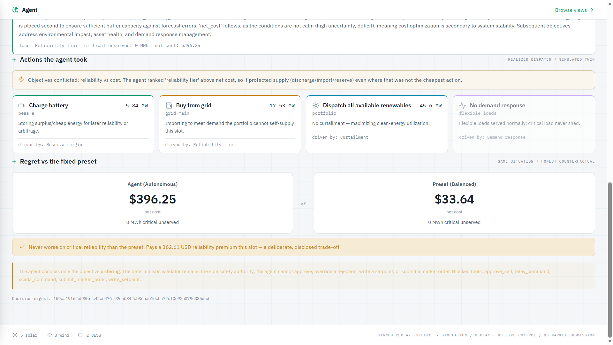

### 1. It reads the situation (uncertainty-conditioned)

A structured, numeric featurizer summarizes each slot — no free text reaches the solver:

| Feature | Meaning |
|---|---|
| `renewable_available_mw`, `demand_mw`, `net_margin_mw` | supply, demand, and their gap |
| `price_usd_per_mwh` | scenario market price this slot |
| `forecast_band_width_mw` | **P90 − P10** at this slot (conformal-style band) |
| `uncertainty_ratio` | band width ÷ max(renewable, 1) — the key uncertainty signal |
| `bess_soc_fraction` | storage state of charge |
| `bess_outage`, `tie_derated`, `weather_event`, `demand_spike` | live contingency flags |

The **scientific core** is in that fifth row: the agent conditions its criteria on the
forecast conformal band width from the forecasting layer. Wide band or an active
contingency → it leads with reliability and reserve. Tight band and calm, high price with a
surplus → it leans into cost/revenue. That linkage — *forecast uncertainty drives the
decision objective* — is the novel bit, and it is honest heuristic logic you can read in
`agent/objective_agent.py`, not a black box.

### 2. It proposes an ordering (two interchangeable brains)

The agent is **brain-agnostic**. A deterministic brain is always available; Gemini is the
primary brain when enabled.

- **`GeminiBrain`** (`gemini-2.5-flash` via Vertex AI, `us-central1`) — receives the
  numeric situation and returns a strict JSON object `{objective_order, rationale,
  confidence}`. The output is **sanitized** before use: the model can only reorder a fixed
  vocabulary and must keep a safety-tier objective first. **No number the model emits ever
  reaches the operator** — only an ordering and a rationale. On any error it falls back to
  the deterministic brain and labels the rationale `[gemini error: …]`.
- **`DeterministicBrain`** — a transparent, uncertainty-conditioned policy that derives the
  ordering from thresholds calibrated to the demo's real distributions. Always on, hermetic,
  free; keeps tests reproducible and the demo bulletproof.

The ordering is drawn from a **fixed 10-objective vocabulary**, three of which are
non-negotiable **safety-tier** objectives that must lead every ordering:

```
safety tier (one MUST lead):  critical_service_margin · required_reliability_tier ·
                              same_non_negotiable_safety_tier
then, in any order the brain chooses:
  reserve_margin · reliability_event_count · net_cost · carbon ·
  curtailment · bess_wear · dr_activation
```

### 3. It critiques itself (reflective loop)

The agent runs a bounded **propose → optimize → validate → critique** loop (max 3
iterations). It calls the real MILP planner with its chosen ordering, runs the independent
safety validator on the result, and if the validator rejects, it reads the violation and
re-derives a harder, reliability-first ordering. Every iteration is recorded with its
status, critical-unserved, and net cost.

### 4. It takes actions — and resolves the conflict in the open

This is the "unlike a chatbot, the agent takes actions" requirement, made concrete. For the
chosen ordering, the optimizer produces a **realized dispatch cluster**, which the agent
surfaces in P4's exact action vocabulary — each action tagged with the objective that drove
it, plus a one-line conflict note.

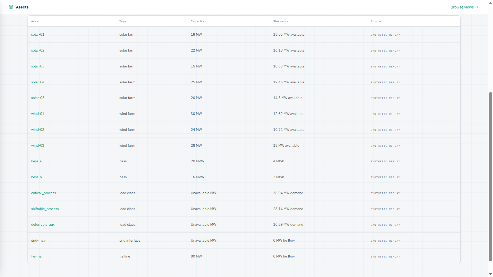

In the slot shown above the agent reports plainly: *"Objectives conflicted: reliability vs
cost. The agent ranked 'reliability tier' above net cost, so it protected supply
(discharge/import/reserve) even where that was not the cheapest action."* The four action
cards — charge BESS, buy from grid, dispatch all renewables (no curtailment), no demand
response — each name their driving objective.

### 5. It reports honest regret versus the fixed preset

For every autonomous choice the agent computes the **counterfactual**: what the fixed
"Balanced" preset would have done on the *same* situation. It shows both side by side. The
invariant we enforce (and test): **the agent is never worse than the preset on critical
reliability.** When it chooses reliability over cost, it shows the premium it paid — e.g.
*"Pays a 362.61 USD reliability premium this slot — a deliberate, disclosed trade-off."*
That is the opposite of a highlight reel: the agent sometimes costs more, and says so.

### 6. Safety is not the agent's to override

The agent **only chooses the objective ordering.** The deterministic validator remains the
sole safety authority. The agent cannot approve a decision, override a rejection, write a
setpoint, or submit a market order. These tools are **hard-blocked** and listed in the UI:

```
blocked: approve_self · relay_command · scada_command · submit_market_order · write_setpoint
```

---

## Architecture

The system is a single, auditable pipeline from typed input to signed evidence, with the
**agent sitting at the objective-selection seam** just before the optimizer.

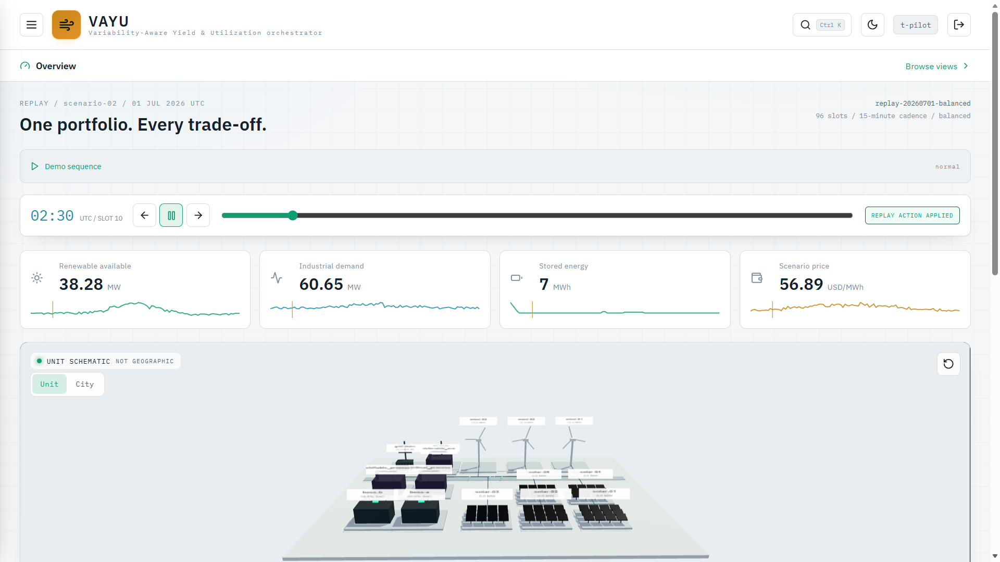

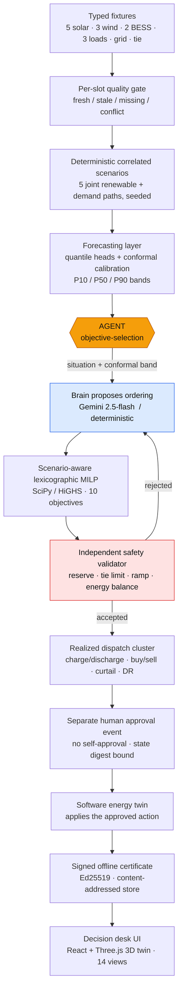

**The single most important design decision:** the agent shapes *only* the objective
ordering (the amber node). Everything downstream — the MILP, the validator, approval, the
twin, the certificate — is deterministic and independently checkable. The intelligence picks
*what matters now*; the deterministic machinery guarantees *what is safe*.

### Why a fixed MILP + an agent, rather than an end-to-end policy

An end-to-end neural policy that emits setpoints directly cannot be given a hard safety
guarantee, and P4 explicitly demands reliability be non-negotiable. By letting the agent
choose the *criteria* and a verified lexicographic MILP choose the *actions*, every action
is feasible-by-construction and re-checked by an independent validator — while the agent
still delivers the autonomy and situational judgement the Agentic Edition asks for.

---

## The decision, every 15 minutes

The portfolio, the actions, and the objectives are exactly P4's operating example.

### The portfolio (canonical demo roster)

Declared in `fixtures/demo_portfolio.json`, replayed over 96 15-minute slots from
`2026-07-01T00:00:00Z`.

| Class | Assets | Capacity |
|---|---|---|
| Solar farms (5) | solar-01…05 | 18 / 22 / 15 / 25 / 20 MW |
| Wind farms (3) | wind-01…03 | 30 / 24 / 28 MW |
| Battery storage (2) | bess-a / bess-b | 20 MWh (±8 MW) / 16 MWh (±6 MW), with reserve + terminal targets |
| Industrial loads (3) | critical_process · shiftable_process · deferrable_aux | critical never shed; two flexible under DR contract |
| Grid interface | grid-main | 75 MW import / 45 MW export, loss + fee |
| Tie line | tie-main | 80 MW, ramp-limited, deratable |

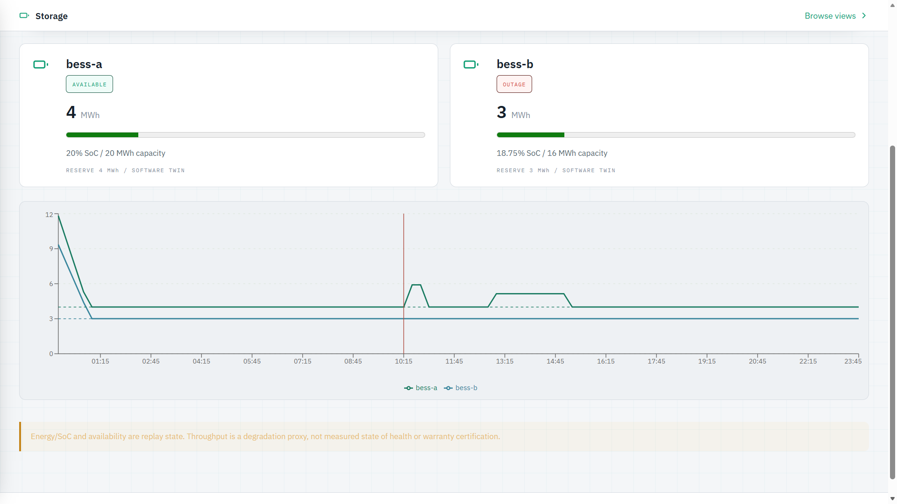

### The actions the agent can take

Exactly P4's action menu, realized by the optimizer and surfaced per slot:

- **Battery** — charge, discharge, hold / reserve-protect (per BESS, in MW + resulting SoC)
- **Market** — buy from grid, sell to grid, hold / delay the trade
- **Renewables** — curtail (or dispatch all available, maximizing clean-energy use)
- **Demand** — trigger demand response (shed / shift priced flexible load); critical load is never shed

### The objectives that compete

Minimize electricity cost, carbon, curtailment, battery wear, DR activation. Maximize
reliability, reserve margin, clean-energy utilization. These conflict constantly — the
agent's job is to decide their *order* for the moment, and the regret table makes the
trade-off legible.

### Live control — drive the twin yourself

The Overview exposes a **simulated-twin live-control panel**: dispatch the BESS, curtail
renewables, shift flexible load, trigger demand response, and watch the slot cost delta,
effective demand, and import/export respond — against the software twin, never a grid.

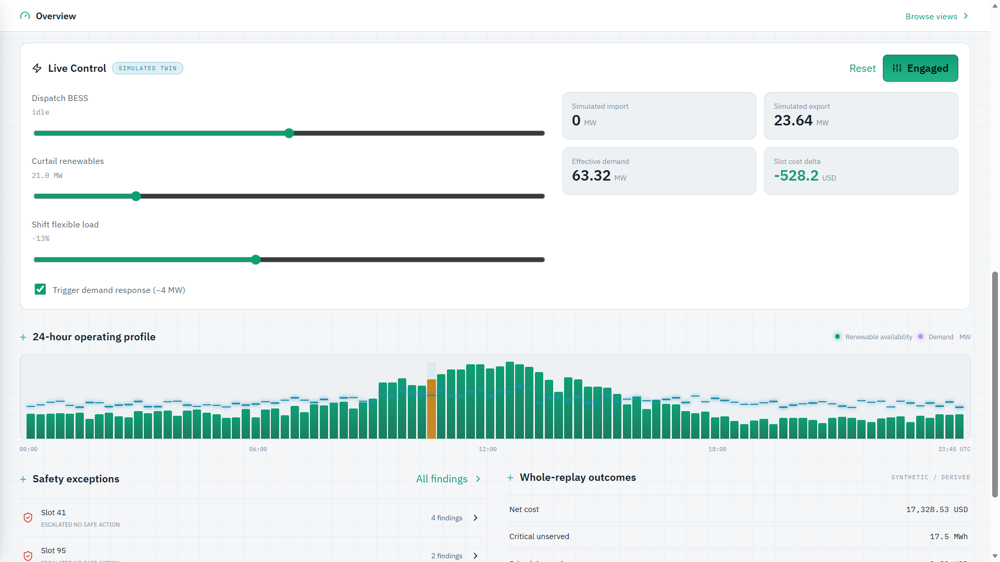

---

## Measured results and baselines

### Forecasting baselines — the honest comparison

The forecasting layer ships a baseline harness that scores our residual quantile model
against four baselines on **one shared mask** (n = 576) with Diebold–Mariano significance.
The result below is served live in the **Science** view and stored as a content-addressed
artifact — reproduce it with `experiments/run_baselines.py`.

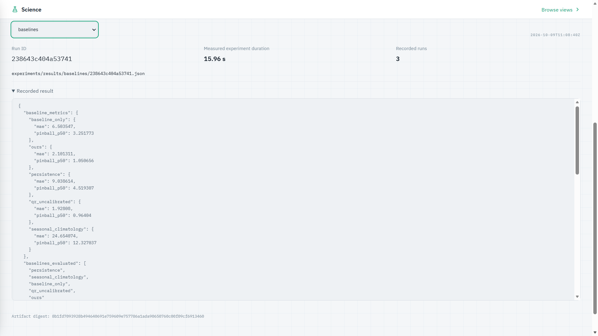

| Model | MAE | Pinball (p50) | vs ours (Diebold–Mariano) |
|---|---|---|---|
| seasonal_climatology | 24.654 | 12.327 | ours wins, p ≈ 0 |
| persistence | 9.039 | 4.519 | ours wins, p ≈ 0 |
| baseline_only (persist⊕clim blend) | 6.504 | 3.252 | ours wins, p ≈ 0 |
| **ours (residual quantile)** | **2.101** | **1.051** | — |
| qr_uncalibrated | **1.928** | **0.964** | **ours LOSES, p = 3.6×10⁻⁴** ← reported, not hidden |

**What this says, honestly.** Our model beats persistence, climatology, and their blend by
wide, significant margins — but it **loses to the uncalibrated quantile baseline** on this
shared synthetic mask. We publish that loss because a comparison that only shows wins is not
a comparison. The run is explicitly labelled **Tier C synthetic — fairness machinery and
determinism only; no real-skill claim** in the artifact itself. These numbers demonstrate
the *evaluation discipline* (shared mask, DM test, wins *and* losses, seeded determinism),
not a leaderboard score.

### Planner versus a recorded baseline (same realized path)

The **Economics** view records the scenario-aware planner against a recorded baseline on the
identical synthetic realized path. It is labelled **"same synthetic realized path / not a
savings guarantee"** — because a single-path difference is an illustration, not a promise.

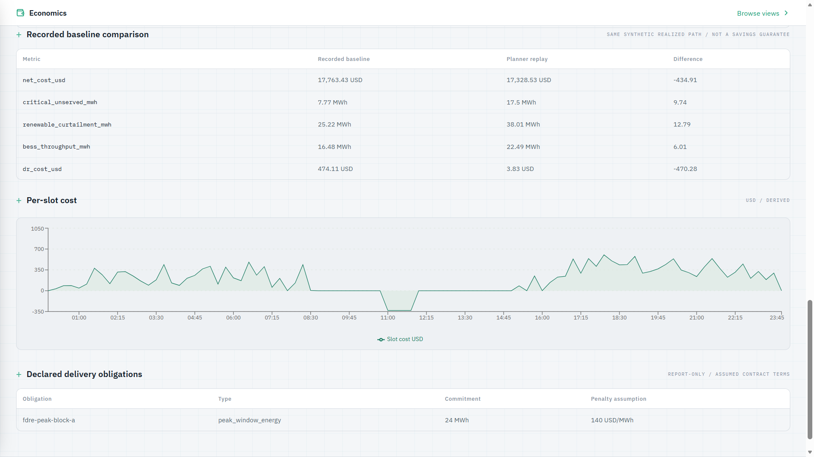

| Metric | Recorded baseline | Planner replay | Difference |
|---|---|---|---|
| `net_cost_usd` | 17,763.43 | 17,328.53 | **−434.91** |
| `dr_cost_usd` | 474.11 | 3.83 | **−470.28** |
| `critical_unserved_mwh` | 7.77 | 17.5 | +9.74 |
| `renewable_curtailment_mwh` | 25.22 | 38.01 | +12.79 |
| `bess_throughput_mwh` | 16.48 | 22.49 | +6.01 |

Note the planner replay shows **more** critical-unserved on this path than the recorded
baseline — again, reported rather than buried. The point of the Economics view is a fully
itemized, provenance-tagged account (import/export MWh, market revenue, carbon kgCO₂e, the
carbon factor as a `scenario_assumption`), not a single flattering number.

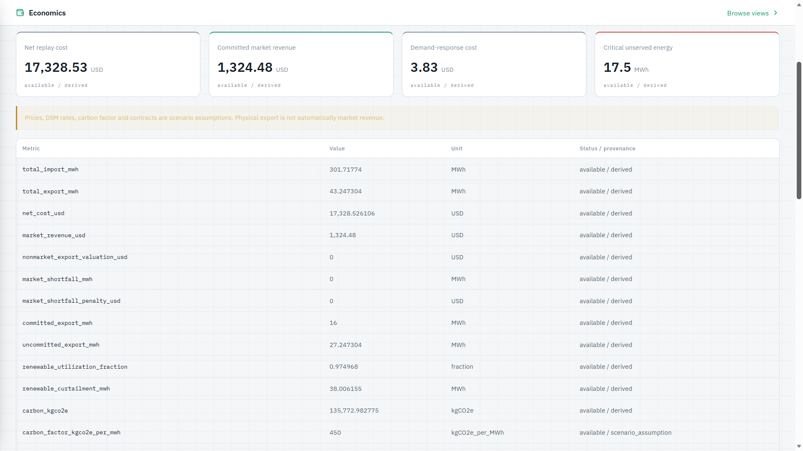

### Safety — rejection is an operating outcome

The independent validator checks every proposal against hard constraints and emits
fatal/warning findings. When no safe action exists it returns
`ESCALATED_NO_SAFE_ACTION` with recovery options — this is a **200 with a rejected
envelope**, not an error. The demo's realized path contains genuinely unsafe slots (e.g.
slot 41 during a BESS outage + tie derate + demand spike), and the UI shows them.

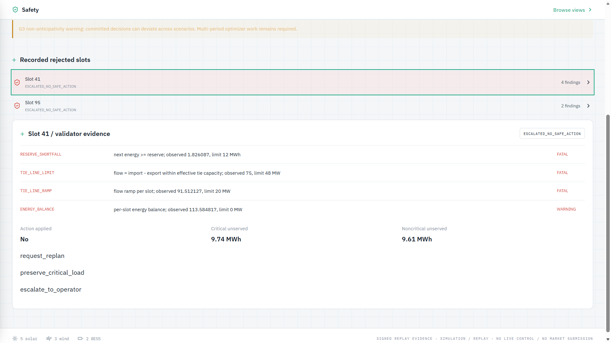

Validator finding codes (all in `validator.py`): `RESERVE_SHORTFALL`, `TERMINAL_TARGET`,
`TIE_LINE_LIMIT`, `TIE_LINE_RAMP`, `GRID_SIMULTANEOUS_IMPORT_EXPORT`, `ENERGY_BALANCE`.
Recovery options: `request_replan`, `preserve_critical_load`, `escalate_to_operator`.

> **Known limitation, stated plainly (G3):** committed decisions can deviate across the five
> scenario paths — full multi-period non-anticipativity work remains. The UI carries this
> warning rather than hiding it.

---

## Forecasting and scenarios

The forecasting layer (`forecasting/`) is a four-stage chain — features → quantile heads →
conformal calibration → scenario paths — with a single leakage choke point and a calibration
admissibility invariant, covered by its own test block (the `test_forecasting_*` suite).

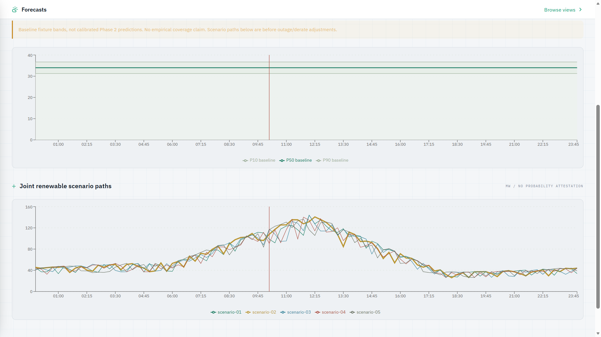

- **Conformal bands.** The P10/P50/P90 bands drive the agent's `uncertainty_ratio`. The UI
  is explicit that the bands shown in the demo are **baseline fixture bands, not calibrated
  Phase-2 predictions** — no empirical coverage is claimed on the demo fixture.
- **Correlated scenarios.** Five joint renewable+demand paths are generated with a seeded
  method so that weather/PV/wind/demand shocks are **correlated, not independent per-asset
  noise** — labelled `MW / no probability attestation`.

### Storage — software twin of the batteries

The **Storage** view tracks per-BESS energy, SoC, reserve floors, and availability
(including the bess-b outage window in the demo), with the honest caveat that throughput is
a **degradation proxy, not a measured state-of-health or warranty certification.**

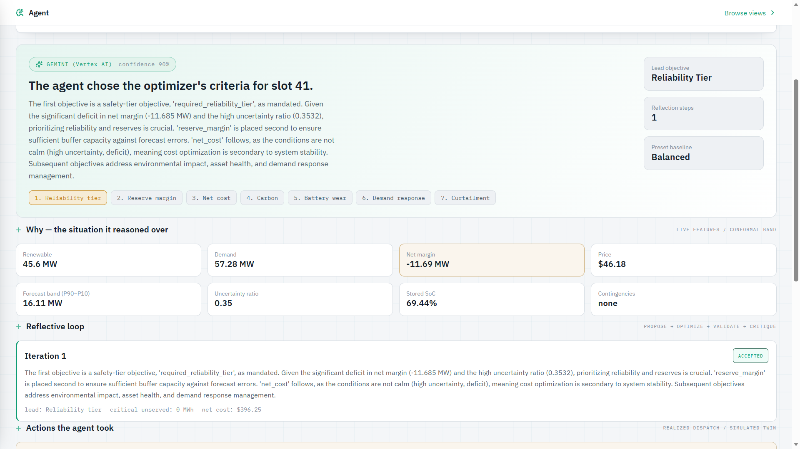

---

## The decision desk UI

React 19 + TypeScript + a lazily loaded Three.js portfolio schematic. Fourteen views, all
reading from the same backend the agent runs on, all carrying the persistent
`SIMULATION / REPLAY · NO LIVE CONTROL / NO MARKET SUBMISSION` scope label.

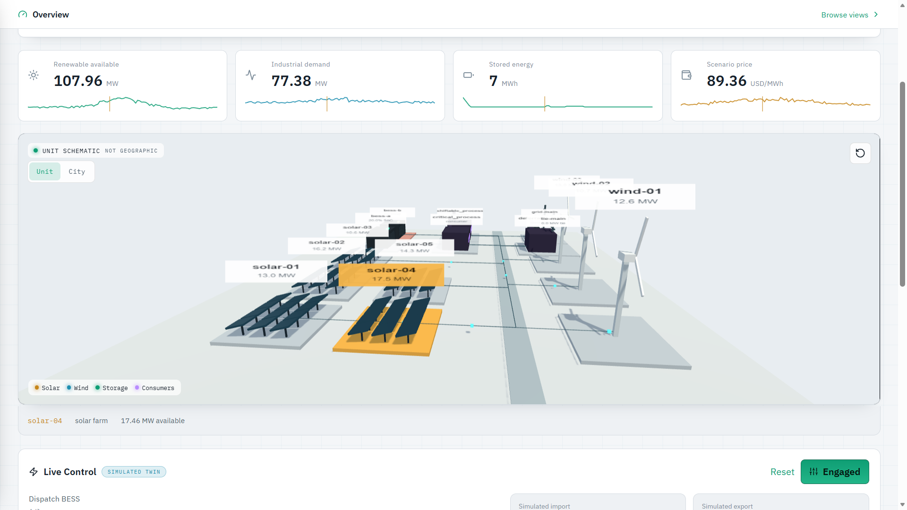

- **Overview** — 3D portfolio twin (unit / city scale), live slot metrics, 24-hour operating
  profile, the simulated-twin live-control panel, safety exceptions, whole-replay outcomes.
- **Agent** — the P4 centrepiece: chosen criteria + rationale, situation features with the
  conformal band, reflective loop, actions taken with objective attribution, regret vs
  preset, safety guardrails.
- **Assets / Storage / Forecasts / Economics / Safety / Science / Decisions / Evidence** —
  the full audit surface, each with provenance labels.
- **Hardware** — a field-loop **concept**, labelled honestly (next section).

The 3D geometry is a **schematic, not surveyed geography or validated network physics** —
and the UI says so (`UNIT SCHEMATIC · NOT GEOGRAPHIC`).

---

## Field hardware — a labelled concept, not a built device

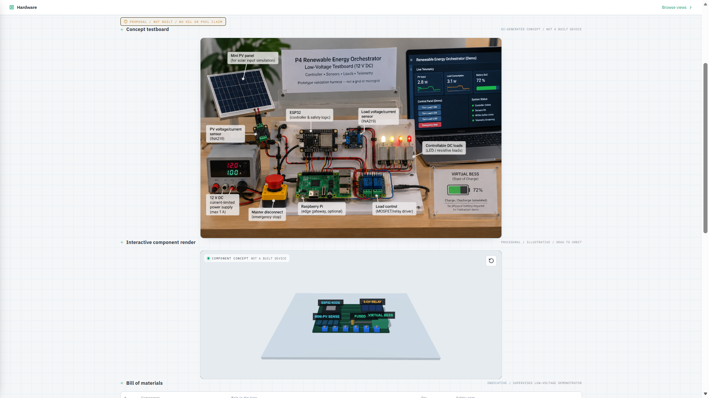

The Hardware view presents a low-voltage (12 V DC) ESP32-based testboard concept for closing
the loop with real sensors and loads. It is marked, unmissably, **"PROPOSAL / NOT BUILT / NO
HIL OR PHIL CLAIM"** and **"AI-GENERATED CONCEPT · NOT A BUILT DEVICE."** We show the design
and bill of materials; we do not claim a built or hardware-in-the-loop system. This is the
honest boundary of the current submission.

---

## Quick start

**Prerequisites:** Python **3.13**, Node **≥ 20**, PowerShell (the normative wrappers are
PowerShell). PostgreSQL and Redis are not required — the engine is self-contained. Gemini is
optional; without it the agent uses the deterministic brain.

Dependencies install into `monsoon_grid/runtime/site-packages` (never into `.venv`), via the
provided wrapper. From the repository root:

```powershell
# 1. Set up the engine runtime (installs into runtime/site-packages)
& .\monsoon_grid\scripts\setup.ps1 -Rebuild

# 2. Run the full test suite  -> expect 364 passed, 1 skipped
& .\monsoon_grid\scripts\test.ps1

# 3. Deterministic replay of the 96-slot portfolio
& .\monsoon_grid\scripts\replay.ps1 -Seed 20260701 -Policy balanced

# 4. Produce the signed demo evidence (replay + certificate)
& .\monsoon_grid\scripts\run_demo.ps1

# 5. Verify the signed certificate offline
& .\monsoon_grid\scripts\verify_certificate.ps1 -CertificatePath .\monsoon_grid\runtime\artifacts\certificate.json
```

### Build and serve the decision desk UI

```powershell
npm --prefix .\monsoon_grid\src\monsoon_grid\ui ci
npm --prefix .\monsoon_grid\src\monsoon_grid\ui run build
$env:MONSOON_GRID_DEV_BEARER_TOKEN = '<a-disposable-local-token>'
& .\monsoon_grid\scripts\start.ps1 -Port 8017
#  -> http://127.0.0.1:8017/ui/   (enter the token to connect)
```

### Turn the Gemini brain on (optional)

```powershell
$env:VAYU_AGENT_BRAIN   = 'gemini'
$env:VAYU_GCP_PROJECT   = '<your-gcp-project>'
$env:VAYU_VERTEX_LOCATION = 'us-central1'
$env:VAYU_GEMINI_MODEL  = 'gemini-2.5-flash'
# requires Vertex AI enabled + application-default credentials with roles/aiplatform.user
```

With the brain off (the default), the Agent view still shows the full agentic reasoning,
produced by the deterministic brain and badged as such.

---

## Reproduce the key numbers

| Claim in this README | Command | Expect |
|---|---|---|
| 364 tests pass | `& .\monsoon_grid\scripts\test.ps1` | `364 passed, 1 skipped` |
| Baseline table (incl. our loss) | `python experiments/run_baselines.py` | `ours` MAE 2.101; `qr_uncalibrated` 1.928 (wins) |
| Agent chooses criteria + takes actions | `GET /api/agent/deliberate?slot=41&policy=balanced` | ordering, rationale, 4 actions, conflict note, regret |
| Validator rejects unsafe slots | open **Safety** view, slot 41 | `ESCALATED_NO_SAFE_ACTION`, fatal findings |
| Signed certificate verifies offline | `verify_certificate.ps1` | verification passes, persistence consistent |

---

## Repository structure

```
monsoon_grid/                      # the VAYU engine (original working title)
├── src/monsoon_grid/
│   ├── agent/                      # ★ the P4 agent
│   │   └── objective_agent.py      #   situation featurizer · Gemini + deterministic brains
│   │                               #   reflective loop · action extraction · regret
│   ├── planner.py                  # scenario-aware lexicographic MILP (SciPy / HiGHS)
│   ├── fallback.py                 # labelled deterministic fallback (never called "optimal")
│   ├── validator.py                # independent safety validator — the sole safety authority
│   ├── dispatch.py                 # generation / demand / tie-capacity helpers
│   ├── forecasting/                # features → quantile → conformal calibration → scenarios
│   ├── contracts.py                # typed Pydantic contracts for every artifact
│   ├── api.py                      # FastAPI routes incl. /api/agent/deliberate
│   ├── auth.py                     # OIDC (prod) / disposable dev token (local) · route policy
│   ├── config.py                   # POLICY_OBJECTIVES presets · settings
│   └── ui/                         # React 19 + TypeScript + Three.js decision desk
├── fixtures/                       # canonical demo portfolio, events, forecasts, contracts
├── experiments/                    # baseline / calibration / scenario harness + results
├── deploy/                         # Dockerfile, Cloud Run config, cost model, monitoring
├── scripts/                        # setup · test · replay · demo · verify (PowerShell)
├── tests/                          # 53 files, 364 tests (pytest + Hypothesis)
├── docs/                           # images + security / environment notes
└── trust/                          # demo signing keyring (public by construction)
```

---

## Innovation, positioned honestly

| Dimension | VAYU | Common alternative | Why it matters for P4 |
|---|---|---|---|
| What the agent decides | **the optimizer's objective ordering**, per slot | fixed human-tuned weights | directly answers "the agent selects the criteria" |
| Uncertainty handling | ordering **conditioned on the conformal band width** | ignore forecast spread | wide band → reliability-first, automatically |
| Objective conflict | **shown**: driver per action + one-line conflict note | opaque weighted sum | answers "how actions are chosen when objectives conflict" |
| Honesty of the choice | **regret vs preset**, premium disclosed | only show wins | the agent sometimes costs more, and says so |
| Safety | **independent validator is the sole authority**; agent cannot override | model emits setpoints directly | reliability stays non-negotiable |
| Brain | **Gemini live, deterministic fallback**, UI badges which | single hard dependency | impressive *and* bulletproof |
| Evidence | **signed Ed25519 certificate**, content-addressed store | screenshots | every decision is independently verifiable |
| Baseline reporting | **floor + losses published** (we lose to one baseline) | R²/score alone | demonstration, not highlight reel |
| Scope labelling | **SIMULATION / REPLAY on every surface** | implied "it's live" | no overclaim about grid control |

---

## Scope and honest boundaries

- **This is simulation / replay.** No grid, SCADA, inverter, relay, or market command path
  exists in the code. Every surface says so.
- **Gemini is the one external, non-deterministic component.** Everything else is
  deterministic and reproducible from a seed; the UI badges which brain decided.
- **Prices, carbon, DSM rates, contracts are scenario assumptions**, tagged as such;
  outcomes derived from them are tagged `derived`.
- **Forecast bands in the demo are baseline fixtures**, not calibrated Phase-2 predictions;
  no empirical coverage is claimed on the fixture.
- **The baseline run is Tier-C synthetic** — evaluation discipline, not a skill leaderboard;
  and we lose to one baseline, reported in the table.
- **The 3D twin is schematic**, not surveyed geography or validated network physics.
- **The hardware testboard is a concept**, explicitly not a built or hardware-in-the-loop
  device.
- **Open limitation (G3):** full multi-period non-anticipativity across the five scenario
  paths remains to be completed.

---

## License

Built for the ET AI Hackathon 2026 — P4, Agentic Edition (presented by Accenture).

<p align="center">
  <strong>VAYU — the agent chooses what matters; the validator guarantees what's safe.</strong>
</p>
