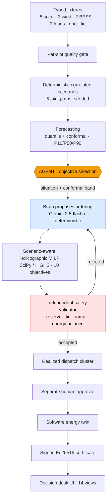

# VAYU — Pitch Deck Content Pack

> **What this file is.** A ready-to-build content pack for a **12-slide** pitch deck (plus a
> demo-video script and submission-form answers) for **ET AI Hackathon 2026 — P4, Agentic
> Edition (Accenture)**. Paste slide-by-slide into Claude/Gauss/PowerPoint. Every number
> here is drawn from the actual VAYU codebase and runs; placeholders for images/diagrams are
> marked `[[ASSET: …]]`. Nothing is invented — where a value is an assumption it says so.
>
> **How to use it.** Each slide has: a one-line **headline**, **on-slide copy** (keep it
> short — judges skim), **speaker notes** (what you say), and **asset placeholders**. A deck
> design-direction section and a demo-video script follow the slides.

---

## Design direction (give this to Claude first)

- **Tone:** confident, engineering-grade, honest. The differentiator is *credibility* — we
  show where we lose, not just where we win. Judges have seen 30 decks; the honest one is
  remembered.
- **Visual language:** clean, light background, one accent (amber `#f59e0b` for "the agent",
  teal/green `#0f9d7a` for "safe/validated", red `#dc2626` for "blocked/unsafe"). Mono font
  for code/metrics, sans for prose. Lots of whitespace. One idea per slide.
- **Rule of thumb:** every slide answers one question in its headline; the body is proof.
- **Recurring footer (small, every slide):** `SIMULATION / REPLAY · NO LIVE CONTROL ·
  Gemini live via Vertex AI`.
- **Winning-deck principles applied** (synthesised from reviewing current hackathon /
  pitch-deck guidance; sources listed at the end, content rephrased for compliance):
  problem-first ordering; one-sentence problem with a concrete hook; a working-demo
  centrepiece that answers "does it actually solve the stated problem, live"; the judging
  rubric visibly addressed; honesty about limits as a trust signal.

---

## SLIDE 1 — Title / Hook

**Headline:** VAYU — the agent chooses what matters; the validator guarantees what's safe.

**On-slide copy:**
- **VAYU** — Variability-Aware Yield & Utilization orchestrator
- An **agentic AI** that operates a renewable-energy portfolio, one 15-minute decision at a time
- ET AI Hackathon 2026 · **P4 — Agentic Edition** · presented by Accenture
- Live demo + public repo (links on the last slide)

**Speaker notes (10s):** "Every 15 minutes a renewable grid changes — clouds, wind, prices,
an outage. VAYU is an AI agent that decides *what to optimise for* in that moment, takes the
action, and proves it was safe."

**Assets:**
- `[[ASSET: VAYU wordmark / logo — the wind-glyph tile from the UI header]]`
- `[[ASSET: hero screenshot — docs/images/overview-twin.png (the 3D portfolio twin)]]`

---

## SLIDE 2 — Team Introduction

**Headline:** Who built it.

**On-slide copy (CONFIRM / EDIT — placeholder):**
- `[[PLACEHOLDER: Team name]]`
- `[[PLACEHOLDER: Member 1 — name, institute, role e.g. "agent + optimizer"]]`
- `[[PLACEHOLDER: Member 2 — name, institute, role e.g. "forecasting + calibration"]]`
- `[[PLACEHOLDER: Member 3 — name, institute, role e.g. "UI + 3D twin"]]`
- `[[PLACEHOLDER: Member 4 — name, institute, role e.g. "deployment + evidence"]]`
- One line: "We build decision systems where the intelligence is accountable."

**Speaker notes:** Keep to 10 seconds. Say the one-line philosophy; it frames the whole deck.

**Assets:**
- `[[ASSET: team photo or 4 avatar circles]]`
- `[[ASSET: small institute logos]]`

---

## SLIDE 3 — Problem Statement

**Headline:** A renewable grid makes a new decision every 15 minutes — and the objectives fight each other.

**On-slide copy:**
- The operating reality (P4): **5 solar farms · 3 wind farms · 2 batteries · industrial
  loads · grid tie · market access.** Every **15 minutes** the situation changes — clouds cut
  solar, wind surges, prices spike, a battery drops out, a line hits its limit, demand jumps.
- **8+ objectives compete at once:** cost ↓, carbon ↓, curtailment ↓, battery wear ↓ vs.
  reliability ↑, reserve ↑, clean-energy use ↑, profit ↑.
- The hard part isn't forecasting. **It's deciding *what to optimise for right now* —
  and proving the choice was safe.**
- P4's exact ask: *"make the selected optimality criteria clear and show how actions are
  chosen when objectives conflict"* — and **"unlike a chatbot, the agent takes actions."**

**Speaker notes:** "A human operator picks the objective weights by gut feel. At 96 decisions
a day across a changing grid, that doesn't scale and isn't auditable. That gut-feel step is
exactly what P4's Agentic Edition asks the agent to own."

**Assets:**
- `[[ASSET: diagram — a clock face at 15-min ticks, each tick showing a different shock
  (cloud / wind / price spike / battery-out / line-limit). Simple, iconographic.]]`
- `[[ASSET: "objectives tug-of-war" graphic — cost vs reliability vs carbon pulling a knob]]`

---

## SLIDE 4 — Proposed Solution

**Headline:** The agent chooses the *criteria*; a verified optimizer chooses the *actions*.

**On-slide copy:**
- **VAYU's agent autonomously selects the optimizer's objective ordering for each slot**,
  conditioned on the live situation **and the forecast uncertainty**, *before* the optimizer
  runs.
- Then it does what a chatbot can't — it **takes actions**: charge/discharge batteries,
  buy/sell/hold on the market, curtail renewables, trigger demand response.
- It shows **what it chose, why, what it did, and what that choice cost** vs a fixed preset.
- **Safety is never the agent's to override.** An independent validator is the sole safety
  authority; five tools are hard-blocked.

**The one-liner:** *"The intelligence picks what matters now; deterministic machinery
guarantees what is safe."*

**Speaker notes:** "This split is the whole design. An end-to-end neural policy that emits
setpoints can't be given a hard safety guarantee. By letting the agent choose the *criteria*
and a verified MILP choose the *actions*, every action is feasible-by-construction and
re-checked — while we still get real agentic autonomy."

**Assets:**
- `[[ASSET: the amber "agent → brain → MILP → validator" strip from the architecture diagram
  (Slide 7), simplified to 4 boxes]]`
- `[[ASSET: screenshot — docs/images/agent-criteria.png (chosen criteria + rationale)]]`

---

## SLIDE 5 — Product Demo (the centrepiece)

**Headline:** One slot, start to finish — the agent decides, acts, and proves it.

**On-slide copy (walk the Agent view, slot 41 — a BESS outage + tie derate + demand spike):**
1. **Reads the situation:** net margin −11.69 MW, forecast band (P90−P10) 16.11 MW,
   uncertainty ratio 0.35, contingencies active.
2. **Chooses the criteria:** leads with **Reliability Tier → Reserve → Net cost → …**
   (Gemini, confidence 90%), because uncertainty + deficit make cost secondary to stability.
3. **Takes the actions:** charge BESS 5.84 MW · buy 17.53 MW · dispatch all renewables
   (no curtailment) · no DR — **each tagged with the objective that drove it.**
4. **Resolves the conflict in the open:** *"reliability vs cost — ranked reliability above
   net cost, so it protected supply even where that wasn't cheapest."*
5. **Reports honest regret:** Agent $396.25 vs Preset $33.64 — *"never worse on critical
   reliability; pays a 362.61 USD reliability premium this slot — a deliberate, disclosed
   trade-off."*

**Speaker notes:** "This is the slide that answers P4 literally. Not a chatbot explaining a
grid — an agent that selects criteria, takes a concrete action cluster, names the conflict,
and quantifies what its choice cost. And notice point 5: it sometimes costs *more*, and says
so. That's the trust signal."

**Assets:**
- `[[ASSET: screenshot — docs/images/agent-criteria.png (top half: criteria + rationale)]]`
- `[[ASSET: screenshot — docs/images/agent-actions.png (actions + conflict note + regret)]]`
- `[[ASSET: optional 15s screen-capture GIF of the Agent tab for the live deck]]`

---

## SLIDE 6 — Key Features / What's Built

**Headline:** A full decision desk, not a demo stub.

**On-slide copy (2-column feature grid):**
- **Autonomous objective selection** — per-slot, uncertainty-conditioned (the P4 core)
- **Reflective self-critique loop** — propose → optimize → validate → critique (≤3 iters)
- **Actions with objective attribution** + one-line conflict resolution
- **Honest regret vs preset** — counterfactual on the same situation
- **Independent safety validator** — fatal/warning findings, escalation path
- **Interactive 3D twin** — unit/city scale, live-control sandbox over a software twin
- **Probabilistic forecasting** — quantile heads + conformal calibration (P10/P50/P90)
- **Signed, verifiable evidence** — Ed25519 certificate per decision, content-addressed store
- **14 views** — Overview, Agent, Assets, Storage, Forecasts, Economics, Safety, Science,
  Decisions, Evidence, Hardware, + research panels

**Speaker notes:** "14 views, all reading the same backend the agent runs on, all carrying the
scope label. This is an operator's desk."

**Assets:**
- `[[ASSET: 2×3 montage of UI screenshots — overview-twin / live-control / assets / storage /
  economics-metrics / safety from docs/images/]]`

---

## SLIDE 7 — Architecture

**Headline:** One auditable pipeline, with the agent at the objective-selection seam.

**On-slide copy:** Typed fixtures → quality gate → correlated scenarios → forecasting (conformal
bands) → **AGENT (objective selection)** → scenario-aware lexicographic MILP → independent
validator → human approval → software twin → signed certificate → UI.

**Mermaid diagram (paste into Claude or render separately):**

**Speaker notes:** "The single most important design decision: the agent shapes *only* the
amber node. Everything downstream is deterministic and independently checkable."

**Assets:**
- `[[ASSET: render the mermaid above as a clean horizontal diagram — amber agent node
  highlighted. (A pre-rendered version is in the repo artifact panel.)]]`
- `[[ASSET: screenshot — docs/images/portfolio-3d.png as a backdrop/inset]]`

---

## SLIDE 8 — AI Models & Technologies

**Headline:** Google Gemini for judgement; verified classical optimization for safety.

**On-slide copy (grouped):**
- **The agent brain (judgement):**
  - **Google Gemini `gemini-2.5-flash` via Vertex AI** (region `us-central1`) — picks the
    objective ordering, returns strict JSON `{order, rationale, confidence}`, **sanitized**
    (can only reorder a fixed vocabulary; a safety-tier objective must lead). **No number the
    model emits reaches the operator.**
  - **Deterministic fallback brain** — transparent uncertainty-conditioned policy; always on,
    hermetic, free. The UI **badges which brain decided.**
- **The optimizer (actions):** scenario-aware **lexicographic MILP** on **SciPy / HiGHS**
  (`scenario-milp-lexicographic-v2`) — BESS actions shared (robust) across 5 scenario paths;
  renewable/grid/DR variables scenario-indexed; binary charge/discharge + grid-direction.
- **Forecasting:** quantile heads + **distribution-free conformal calibration (CQR, Romano
  et al. 2019)**, with EnbPI (Xu & Xie 2021) and ACI (Gibbs & Candès 2021) time-series
  variants, plus a leakage-admissibility invariant.
- **Stack:** FastAPI · Pydantic contracts · React 19 + TypeScript + Three.js · Ed25519
  (cryptography) · Docker · **Google Cloud Run** (live) + Cloud Build / Artifact Registry.

**Speaker notes:** "Gemini does the thing LLMs are good at — contextual judgement about what
matters. It never does arithmetic that touches an operator. The math is a verified MILP."

**Assets:**
- `[[ASSET: logo strip — Google Gemini / Vertex AI, SciPy/HiGHS, FastAPI, React, Three.js, Cloud Run]]`
- `[[ASSET: screenshot — docs/images/agent-criteria.png cropped to the "GEMINI (Vertex AI) · confidence 90%" badge]]`

---

## SLIDE 9 — The Science / Formulas / Execution

**Headline:** Under the hood: a robust MILP, conformal uncertainty, and a verified decision.

**On-slide copy:**

**(a) The agent's decision rule (uncertainty-conditioned):**
> `uncertainty_ratio = (ΣP90−P10 over renewables) / max(renewable, 1)`
> Wide band or contingency → lead reliability/reserve. Tight band + calm + high price +
> surplus → lead net cost. A **safety-tier objective always leads** (10-objective vocabulary,
> 3 of them safety-tier).

**(b) The one-slot robust MILP (per scenario ω):**
> Decision vars: renewable dispatch `r`, BESS charge/discharge `c,d` (+ binary mode),
> import/export `I,E` (+ binary direction), committed/uncommitted export + priced shortfall,
> DR shed/shift, unserved `u`.
>
> SoC transition: `SOC_{t+1} = SOC_t + η_c·c·Δt − d·Δt/η_d`, with `Δt = 0.25 h`
> Reserve/capacity: `reserve ≤ SOC_{t+1} ≤ capacity` · terminal target at final slot
> Grid/tie: `|I−E| ≤ effective_tie`, ramp-bounded; import·export mutually exclusive
> **BESS actions are shared across the 5 scenario paths** (robust); scenario-specific
> variables absorb path divergence. Objectives are optimised **lexicographically** in the
> agent-chosen order.

**(c) Conformal calibration (distribution-free):**
> CQR score `E_i = max(lo_i − y_i, y_i − hi_i)`; band correction `q =` the
> `⌈(n+1)(1−α)⌉`-th order statistic of scores; emit `[lo−q, hi+q]` with a width floor.
> Admissibility invariant: no score with `valid_time + lag > issue_time` may enter state
> (no leakage).

**(d) Execution reality:** on solver unavailable/timeout/error the planner records
`SOLVER_UNAVAILABLE / SOLVER_TIMEOUT / SOLVER_ERROR` and uses a **labelled deterministic
fallback** — *never* called "optimal". Per-slot and per-request time budgets are enforced.

**Speaker notes:** "Three things make this defensible: the decision rule is readable, the MILP
is robust across scenarios not a single forecast, and the uncertainty is distribution-free
conformal — a published method, cited, not hand-waved."

**Assets:**
- `[[ASSET: clean typeset of equations (a)–(c) — use the LaTeX from
  P4_Renewable_Energy_Orchestrator_Evidence_Review.md §"Minimum mathematical model"]]`
- `[[ASSET: screenshot — docs/images/forecasts.png (bands + joint scenario paths)]]`

---

## SLIDE 10 — Validation, Tests & Safety (proof it works)

**Headline:** We publish the floor, report where we lose, and reject unsafe actions.

**On-slide copy:**

**Tests & reproducibility:**
- **364 tests passed / 1 skipped** across **53 test files** (pytest + Hypothesis), re-run on
  this commit. Includes dedicated agent, forecasting, planner, validator, and certificate
  suites.
- Every artifact is **content-addressed and seed-deterministic**; a signed Ed25519
  certificate verifies **offline**.

**Forecasting baselines (shared mask n=576, Diebold–Mariano) — the honest table:**

| Model | MAE | Pinball p50 | vs ours |
|---|---|---|---|
| seasonal_climatology | 24.654 | 12.327 | ours wins, p≈0 |
| persistence | 9.039 | 4.519 | ours wins, p≈0 |
| baseline_only (blend) | 6.504 | 3.252 | ours wins, p≈0 |
| **ours (residual quantile)** | **2.101** | **1.051** | — |
| qr_uncalibrated | **1.928** | **0.964** | **ours LOSES, p=3.6e-4** |

> We report the loss. The run is labelled **Tier-C synthetic — fairness machinery &
> determinism, not a skill leaderboard.** The point is *evaluation discipline*: shared mask,
> significance test, wins **and** losses.

**Multi-day Monte Carlo (orchestrator vs greedy and no-battery operators):** evaluated across
N seeded days with paired mean differences and 95% CIs; we report the days/metrics where a
baseline wins. Tier-C synthetic. See `experiments/results/monte_carlo` and the Science view.

**Safety as an operating outcome:** the validator emits `RESERVE_SHORTFALL`, `TIE_LINE_LIMIT`,
`TIE_LINE_RAMP`, `ENERGY_BALANCE`, … On no-safe-action it returns `ESCALATED_NO_SAFE_ACTION`
(a 200 with a *rejected* envelope) + recovery options. The demo's realized path contains
genuinely unsafe slots and the UI shows them.

**Speaker notes:** "Judges have seen a hundred decks that only show wins. We show the one
baseline that beats us, and we show the slots where the only safe decision was to refuse and
escalate. That's what a real operator trusts."

**Assets:**
- `[[ASSET: screenshot — docs/images/science-baselines.png (recorded baseline JSON)]]`
- `[[ASSET: screenshot — docs/images/safety.png (validator evidence, rejected slot)]]`
- `[[ASSET: screenshot — docs/images/economics-baseline.png (planner vs recorded baseline)]]`

---

## SLIDE 11 — Business Impact & Scalability

**Headline:** An accountable operator-in-a-box — and it scales down to cents and up to a fleet.

**On-slide copy:**

**Why it matters (impact):**
- **Turns 96 gut-feel decisions/day into auditable, uncertainty-aware ones** — with the
  trade-off made explicit every time.
- **Trust is the product.** Every decision is explainable (criteria + rationale), bounded by
  an independent safety authority, and **cryptographically signed** for audit — exactly what a
  utility, VPP aggregator, or C&I site needs before it delegates dispatch.
- **Operator augmentation, not replacement** — a human approval step is built in; the agent
  cannot self-approve.

**Market (positioning — label assumptions):**
- Target users: utilities, **virtual power plant (VPP) aggregators**, C&I microgrid operators,
  renewable IPPs. `[[PLACEHOLDER: cite one TAM figure for grid-management / DERMS software if
  you want a market-size number — label the source]]`
- Differentiator: the **criteria are chosen and explained**, not a black-box setpoint.

**Scalability (engineering reality):**
- **Serverless on Google Cloud Run** — scales to **zero** when idle, autoscales on demand;
  per-slot and per-request time budgets bound latency.
- **Portfolio-agnostic:** assets are typed fixtures — add solar/wind/BESS/loads/ties without
  code change; the MILP and validator generalise.
- **Brain-agnostic:** Gemini or deterministic, swappable by one env var; Gemini cost is
  per-token and **near-zero for this cadence** (one short JSON call per slot, cached).
- Cost line items modelled in `deploy/cost/` (Cloud Run / Vertex / storage) — `[[note:
  current unit prices are marked ASSUMPTION-UNVERIFIED in the repo; flip to verified before
  quoting a figure on-slide]]`.

**Speaker notes:** "The business case is accountability. A utility won't let a black box
dispatch megawatts. VAYU gives them an agent whose every decision is explained, safety-bounded,
and signed. And it runs serverless — pennies idle, scales with the fleet."

**Assets:**
- `[[ASSET: scale toggle screenshot — the Overview "Unit / City" control from overview-twin.png]]`
- `[[ASSET: simple scaling diagram — 1 portfolio → N portfolios on Cloud Run autoscale]]`
- `[[ASSET: optional cost bar — idle (≈$0, scale-to-zero) vs active]]`

---

## SLIDE 12 — Future Roadmap + Ask + Links

**Headline:** What's next, and where to see it.

**On-slide copy:**

**Action set today:** battery, market, curtailment, demand response, load shift, maintenance
(schedule / delay / crew dispatch), and voluntary non-critical reduction. Roadmap:
multi-period non-anticipativity, calibrated Phase-2 forecasts in dispatch, richer market model.

**Roadmap (honest, from the repo's own open items):**
- **Multi-period non-anticipativity (G3):** move from one-slot robust to a true receding-
  horizon multi-period commitment across the 5 scenario paths.
- **Multi-day Monte Carlo (done):** N seeded days vs greedy and no-battery operators with
  paired mean differences and 95% CIs; see `experiments/results/monte_carlo`.
- **Calibrated Phase-2 forecasts in dispatch:** promote the conformal bands from baseline
  fixtures to live calibrated predictions with measured coverage.
- **Close the field loop:** the ESP32 testboard concept → a supervised low-voltage
  hardware-in-the-loop demonstrator (today it is a **labelled concept, not a built device**).
- **Richer market model:** multi-interval markets, ancillary services, real tariff ingestion.

**The ask (tailor to the hackathon):**
- `[[PLACEHOLDER: what you want — e.g. "pilot data from a real C&I site", "mentorship on
  grid-code compliance", "the P4 prize to fund the HIL build"]]`

**Links:**
- **Live demo:** `https://vayu-749096933589.asia-south1.run.app/ui/` — token `vayu-demo-2026`
  → open the **Agent** tab
- **GitHub:** `https://github.com/Shyamistic/V.A.Y.U`
- **Problem statement:** ET AI Hackathon 2026 — **P4, Renewable Energy Orchestrator (Agentic
  Edition)**, presented by Accenture

**Speaker notes:** "We're honest about what's next — multi-period optimization and a real
hardware loop. What's done is a working, deployed, signed, agentic decision desk you can open
right now with that token."

**Assets:**
- `[[ASSET: QR code to the live demo URL]]`
- `[[ASSET: QR code to the GitHub repo]]`
- `[[ASSET: closing hero — docs/images/agent-actions.png or the VAYU wordmark]]`

---

# Demo video script (2–4 min)

> Target 2:45. Record the live UI (Cloud Run). Keep cuts tight. Captions on. The video must
> cover: Introduction, Problem Overview, Live Product Demonstration, AI Capabilities, Key
> Features, Business Impact, Closing. Script below hits all seven.

**[0:00–0:20] Introduction.** On screen: VAYU title + 3D twin.
> "This is VAYU — an agentic AI that operates a renewable-energy portfolio. Five solar farms,
> three wind farms, two batteries, industrial loads, a grid tie. Every 15 minutes, it makes a
> decision — and proves it was safe."

**[0:20–0:45] Problem.** On screen: the clock-of-shocks graphic, then the Overview with a
contingency active.
> "A renewable grid changes every 15 minutes. Cost, carbon, reliability, and curtailment all
> fight each other. The hard part isn't the forecast — it's deciding *what to optimise for
> right now*, and today a human does that by gut feel. P4's Agentic Edition asks the agent to
> own that decision."

**[0:45–1:45] Live demo — the Agent tab (the core).** Screen-record slot 41.
> "Watch one slot. The agent reads the situation — a battery's out, the tie line is derated,
> demand's spiking, net margin is negative, and the forecast band is wide." (point to the
> feature tiles)
> "Gemini — live on Vertex AI — chooses the criteria: reliability first, reserve second, cost
> only after. Here's its reasoning, confidence 90%." (point to rationale + chips)
> "Then it *acts*: charges a battery, imports to cover demand, dispatches all renewables, no
> demand response — each action tagged with the objective that drove it." (scroll to actions)
> "And it's honest: it names the conflict — reliability versus cost — and shows it paid a
> 362-dollar premium versus the fixed preset to keep supply safe. It's never worse on critical
> reliability." (point to the regret cards)

**[1:45–2:10] AI capabilities + safety.** Screen: the brain badge, then the Safety tab.
> "Gemini provides judgement — but it only reorders a fixed objective list and never touches a
> number the operator sees. An independent validator is the sole safety authority: here it is
> rejecting an unsafe slot and escalating, because sometimes the only safe action is to
> refuse."

**[2:10–2:30] Key features + proof.** Quick cuts: 3D twin, forecasts, Science baselines.
> "Behind it: a scenario-aware MILP on HiGHS, conformal-calibrated forecasts, 364 passing
> tests, and a signed certificate for every decision. We even publish the one baseline that
> beats our forecaster — because a demo that only shows wins isn't a validation."

**[2:30–2:45] Business impact + close.** Screen: VAYU wordmark + links.
> "VAYU turns 96 gut-feel decisions a day into auditable, uncertainty-aware ones — explainable,
> safety-bounded, and cryptographically signed. It runs serverless, scales to zero, and it's
> live right now. The agent chooses what matters; the validator guarantees what's safe. Thank
> you."

**Capture checklist:**
- `[[ASSET: screen-record the live Agent tab at slot 41 — the full scroll]]`
- `[[ASSET: screen-record the Safety tab rejected slot]]`
- `[[ASSET: 3s cuts of Overview 3D twin, Forecasts, Science view]]`
- `[[ASSET: title + closing cards with the demo URL + token and GitHub]]`

---

# Submission-form answers (copy-paste ready)

**GitHub Repository URL (≤500 chars):**
> `https://github.com/Shyamistic/V.A.Y.U` — VAYU, the P4 Renewable Energy Orchestrator
> (Agentic Edition). Complete source (agent, scenario-aware MILP, safety validator,
> forecasting, React/Three.js decision desk), README with architecture + install + run steps,
> 364 passing tests, Dockerfile + Cloud Run deploy. Live demo:
> https://vayu-749096933589.asia-south1.run.app/ui/ (token vayu-demo-2026 → Agent tab).

**Problem statement worked on:**
> **P4 — Renewable Energy Orchestrator (Agentic Edition), ET AI Hackathon 2026, presented by
> Accenture.** Build an AI agent that autonomously manages a renewable-energy portfolio (solar,
> wind, batteries, loads, grid, market), re-deciding every 15 minutes to minimise cost and
> carbon, maximise clean-energy utilisation and reliability — making the selected optimality
> criteria clear and showing how actions are chosen when objectives conflict.

---

# Fact sheet (so every slide number is defensible)

| Fact | Value | Where it comes from |
|---|---|---|
| Portfolio | 5 solar (18/22/15/25/20 MW), 3 wind (30/24/28 MW), 2 BESS (20/16 MWh), 3 load classes, grid-main (75 MW imp / 45 MW exp), tie-main (80 MW) | `fixtures/demo_portfolio.json` |
| Cadence | 96 slots × 15 min from 2026-07-01T00:00:00Z | `fixtures/demo_portfolio.json` |
| Objective vocabulary | 10 objectives; 3 safety-tier (one must lead) | `agent/objective_agent.py` |
| Agent brains | Gemini `gemini-2.5-flash` via Vertex AI (`us-central1`) + deterministic fallback | `agent/objective_agent.py` |
| Reflective loop | propose→optimize→validate→critique, ≤3 iterations | `agent/objective_agent.py` |
| Blocked tools | approve_self, relay_command, scada_command, submit_market_order, write_setpoint | `agent/objective_agent.py` |
| Optimizer | scenario-aware lexicographic MILP, SciPy/HiGHS, `scenario-milp-lexicographic-v2`; BESS shared across 5 scenarios | `planner.py` |
| Forecasting | quantile heads + CQR conformal (Romano 2019), EnbPI (Xu&Xie 2021), ACI (Gibbs&Candès 2021); leakage-admissibility invariant | `forecasting/calibration.py` |
| Baselines (n=576, DM) | ours MAE 2.101 / pinball 1.051; persistence 9.039; climatology 24.654; blend 6.504; **qr_uncalibrated 1.928 (beats ours, p=3.6e-4)** | `experiments/results/baselines/238643c404a53741.json` |
| Planner vs recorded baseline | net cost −434.91 USD; dr cost −470.28; crit unserved +9.74 MWh (reported) | Economics view / `economics-baseline.png` |
| Tests | 364 passed, 1 skipped, 53 files (pytest + Hypothesis) | full-suite run on this commit |
| Validator findings | RESERVE_SHORTFALL, TERMINAL_TARGET, TIE_LINE_LIMIT, TIE_LINE_RAMP, GRID_SIMULTANEOUS_IMPORT_EXPORT, ENERGY_BALANCE; status ESCALATED_NO_SAFE_ACTION | `validator.py` |
| Evidence | Ed25519 signed certificate, content-addressed store, offline-verifiable | `README.md` / certificates |
| Deployment | Google Cloud Run (asia-south1), scale-to-zero; Gemini live via Vertex AI (us-central1) | `deploy/` |
| Scope | SIMULATION / REPLAY · no grid/SCADA/inverter/relay/market command path | repo-wide label |

**Honesty flags to keep on-deck (they build trust):**
- Forecast bands in the demo are **baseline fixtures**, not calibrated Phase-2 predictions.
- The baseline run is **Tier-C synthetic**; we **lose to one baseline** (shown).
- The 3D twin is **schematic**, not surveyed geography.
- The hardware testboard is an **AI-generated concept, not a built device**.
- Prices/carbon/DSM/contracts are **scenario assumptions**; cost unit prices are
  **ASSUMPTION-UNVERIFIED** in `deploy/cost/` until flipped.
- Open limitation **G3**: full multi-period non-anticipativity remains.

---

# Image asset index (already in the repo under docs/images/)

| Placeholder in slides | File |
|---|---|
| Overview / 3D twin hero | `docs/images/overview-twin.png` |
| Portfolio 3D (unit schematic) | `docs/images/portfolio-3d.png` |
| Live control sandbox | `docs/images/live-control.png` |
| Agent — chosen criteria + rationale | `docs/images/agent-criteria.png` |
| Agent — actions + conflict + regret | `docs/images/agent-actions.png` |
| Assets table | `docs/images/assets.png` |
| Storage / BESS | `docs/images/storage.png` |
| Forecasts (bands + scenarios) | `docs/images/forecasts.png` |
| Economics — metrics | `docs/images/economics-metrics.png` |
| Economics — baseline comparison | `docs/images/economics-baseline.png` |
| Safety — validator evidence | `docs/images/safety.png` |
| Science — baseline run | `docs/images/science-baselines.png` |
| Hardware concept | `docs/images/hardware-concept.png` |

---

# Sources consulted for winning-deck structure

Synthesised from current hackathon-pitch and pitch-deck guidance; **content was rephrased for
compliance with licensing restrictions** and no source is quoted beyond a short phrase:
- [SlideModel — hackathon presentation](https://slidemodel.com/hackathon-presentation/)
- [Ink Narrates — hackathon pitch deck](https://www.inknarrates.com/post/hackathon-pitch-deck)
- [SlideGenius — hackathon pitch deck elements](https://www.slidegenius.com/cm-faq-question/what-are-the-key-elements-to-include-in-a-hackathon-pitch-deck-for-a-successful-presentation)
- [lablab.ai — how to win an AI hackathon](https://lablab.ai/guide/how-to-win-an-ai-hackathon)
- [Masai — how to win an AI hackathon 2026](https://www.masaischool.com/blog/how-to-win-an-ai-hackathon-in-2026-full-guide/)
- [Capitaly — 3-minute AI agent demo](https://www.capitaly.vc/blog/how-to-build-ai-agent-demo-closes-vcs-3-minutes)
- [AngelHack — hackathon demo tips](https://angelhack.com/blog/10-tips-to-help-you-rock-your-next-hackathon-demo/)
- [Visme — pitch deck structure](https://visme.co/blog/pitch-deck-structure/)
- [Cirrus Insight — startup pitch deck examples](https://www.cirrusinsight.com/blog/startup-pitch-decks)

**Distilled principles applied in this pack:** problem-first ordering with a one-sentence hook;
a working-demo centrepiece that answers "does it solve the stated problem, live"; the judging
rubric (problem/solution/architecture/AI/demo/impact/scalability/roadmap) each given a slide;
honesty about limits used as a differentiator; one idea per slide; links + QR for instant
verification.
